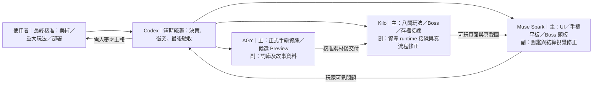
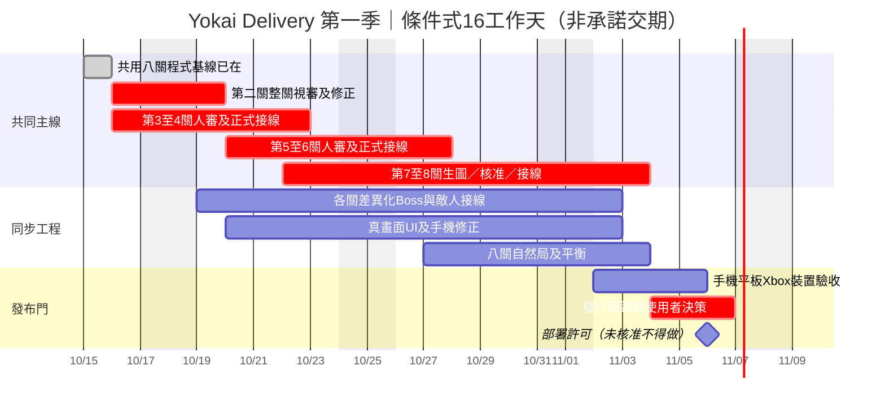

# 妖怪快遞社 Yokai Delivery｜第一季遊戲企劃與製作總計畫

## 2026-10-15 15:27｜生圖額度、Codex 接手與不用人審的工程項目（最新查核）

- AGY 專用 image-generator 子 Agent 於台灣時間 2026-10-15 08:15:34，呼叫 gemini-3.1-flash-image 第三張圖遭 Google RESOURCE_EXHAUSTED 429。原始 quotaResetTimeStamp = 2026-10-20T08:26:52Z，即 **10 月 20 日 16:26:52 台灣時間**。這是服務端重置預告，在此之前不要反覆生圖測額度；AGY 文字／程式功能正常。
- Codex 現在的 GPT-6.1-Sol High 工作階段已實際確認具備原生 image_gen__imagegen 工具與 imagegen Skill，可獨立替代 AGY 生產候選圖，但仍受該工具自身配額；未獲人審的圖不可接正式遊戲。沒有使用者明確要求生圖時不消耗圖像生成額度。
- 已建立本機 M1 檢查點 54a4690（2026-10-15 15:15），不代表 337 筆殘留 dirty 被異地備份；目前仍不自動 Push／Deploy。

**非人審後續最有價值的工作**：Kilo 核對第3–8關 enemy.bossTheme 是否有真正 Boss AI consumer，若已定義既有 slam／charge／ring／tide 模板可安全按資料配置，只做資料接口接線，不自行創造未核准攻擊或改平衡；其次執行代表關卡近10分鐘的連續運行／記憶體／升級／配送時序檢查，不得把加速模擬或 Chrome 無人操控稱為真人試玩。Muse 只處理真Chrome手機橫式及平板 Stage3–8 的可重現 Boss／結算／圖鑑／2D-2.5D遮擋或觸控 Bug。AGY 當前不用再整理已PASS審圖工具或重試429。
沒有安全且實際玩家有感的剩餘工程，應標 WAITING_ART、WAITING_DEVICE 或 WAITING_HUMAN，而非製造測試／空轉。

## 2026-10-15｜使用者授權本機 Checkpoint Commit（取代舊禁止 commit 條款）

使用者已明確同意：每完成且驗證通過一個重要里程碑，自動建立一次本機 Git Checkpoint Commit；沒有授權 Push 或 Deploy。
- 有 Agent 正修改的檔案不可提交，待它交卷且相關測試確認後再提交。
- 嚴禁全庫 stage（add -A / add . / add -u）；必須逐檔白名單 git add -- 並檢查 staged 檔案、git diff --cached --check。
- 絕不提交音訊及語音素材（assets/audio、art/audio、js/audio.js），也不提交金鑰、環境檔、暫存截圖、拒稿、未核准 art 候選、個人機密。
- 只收已驗證功能程式、必要來源與已核准的正式生產圖，核准狀態不明即排除。
- 記錄 commit hash、已提交範圍與仍未提交的項目。本機 commit 不是異地備份，遠端 Push 仍須另行批准。
- 繼續禁止 reset / clean / checkout / 任何會清除 dirty 工作樹的操作。

## 2026-10-15 14:21｜使用者最新決策：先完成全部功能接線，再集中審核美術與語音（最高優先）

**本節覆蓋後文所有「等美術核准才能寫程式／八關接線受阻」的舊順序，舊內容僅作溯源。** 使用者授權把第一季八關**除正式美術圖、語音包外的所有線先接通**；到時再一次檢查各關圖檔。這不是授權自行核准圖檔、調整音訊或提前發行。

### 本輪真正的開發目標：八關功能接線完成（CODE_COMPLETE，非 ART_COMPLETE）

1. 八個 stageId 都必須走同一可執行資料導向路徑：關卡選擇／任務詞包／場景配置／地面與地標插槽／敵人生成與行為／Boss封印與出場／結算／解鎖／失敗／卡片收藏／保存與返回；這是唯一功能完成標準。已有八關流程9/9加速PASS，**不可當作所有資產插槽與獨特Boss都已接通**。
2. 依**實際存在的正式資產**建「八關 stageId→圖像插槽」映射和缺圖降級處理，至少涵蓋地面、場景、建築、裝飾、地標、專怪 idle/attack、Boss idle/attack、UI Boss 標識。插槽可先處於 WAITING_ART、用現役已存在的共用圖或清楚標明缺圖，**不准以新幾何／色塊冒充最終素材、不准將 art/ 未核准候選偷偷接 assets/img/ 生產環境**。把「引擎槽已可插」與「正式圖已核准接入」分別記錄。
3. 先實作數據與邏輯層面的八關差異化怪物／Boss（盡量重用現有追擊／投射／衝刺／預警行為骨架；不需要圖片就能測觸發與判定）。如涉及**全新未核准玩法**，僅留下不啟用的擴充槽與明確待決，不代使用者設計。
4. 第1–8關到站題目、長假名、Boss題板、HUD、圖鑑、結算在真頁面要能跨關正確帶入 stage metadata，不因圖片尚缺而卡死或存檔汙染；只修實際可復現的UI缺陷。
5. 「功能完成」的交付不是一篇報告或 N 個測試，而是**可本機試玩的八關、完整共用流程、每關可替換的 asset slot、清楚缺圖名單**。最多一個聚焦的跨關流程確認與必要真頁面截圖；加速模擬必標示，不能說是真機10分鐘。

### 功能先行的兩道里程碑（取代後文的美術→接線硬相依）

- **M1：CODE_COMPLETE / 所有八關的程式、資料、UI、敵人/Boss邏輯和圖像/語音介面就緒**。語音只保留既有呼叫路徑，不讀、不變更、不測真實語音；圖片只接現役核准素材或安全fallback，未核准候選仍隔離。由 Kilo 做功能整合、Muse 真頁UI與AGY資料/映射核對；Codex 一次性核對接線缺口。
- **M2：ART_AND_AUDIO_APPROVED / 使用者集中審圖、決定是否解凍語音**。在 M1 之後進行批次圖片核准→替換→自然遊玩／實機→發行驗收。沒有明確語音解凍就仍保持凍結；不能以 M1 作為部署許可。

### 明確分工與 writer 範圍

| Agent | 主工作 | 副工作 | 本輪獨占檔 |
|---|---|---|---|
| Kilo | 八關 runtime asset 插槽、按需載入與正式圖缺失 fallback；真正的專怪/Boss行為接線 | 八關本機可玩流程、解鎖、存檔與物件一致性 | js/assets.js、js/game.js、js/world.js、js/renderer.js、js/store.js 與 tests/kilo-* |
| AGY | 每關場景／詞包／敵人／Boss 資料配置與穩定 stageId，將已有內容對齊 Kilo 的既有API | 完整缺圖表、日後素材替換路徑（不生成或接候選） | js/words.js、js/story-dialogue.js、art/ 候選、必要新資料驗證檔 |
| Muse Spark | Stage1–8 Boss題板/任務牌/UI從 stage metadata 正確渲染 | 手機/平板跨關介面、字卡與結算；真Bug才修 | js/ui.js、js/card-gallery-ui.js 與 tests/muse-* |
| Codex | 簡短系統級統整：找出八關缺少的接線、對齊三Agent接口而**不搶檔** | 最後 M1 一次性整合驗收 | 只讀實際源碼；如需寫接口契約，寫一份小型共享規範而非大報告 |

**派工順序**：Kilo 先清點目前只載第1/2關地圖的 assets.js（loadStageMapArt(stageId) 尚有二選一映射），找出可用槽→先改 data-driven 8關 asset mapping；AGY 同時核對八關 visual/敵人/Boss metadata 及安全待圖索引，不覆寫Kilo介面；Muse 同時用真頁面核對 UI stage metadata。三者交付後 Codex 只做一次跨檔整合。優先修可玩性阻塞，禁止為了保持Working而累積小測試／報告／預覽。

**長期保護**：數百未提交變更不動；不得 git commit、push、deploy、reset、clean、checkout；音訊/TTS/BGM/API金鑰完全凍結；尚待審稿與源母版保持原樣，使用者到時集中決定。甘特圖日期為舊的條件式示意，應按本節的新「M1功能先行 → M2美術/語音」重新理解，不把美術核准當 M1 的阻塞。

> **版本**：2026-10-15 v1（企劃／派工基準，不等於部署許可）  
> **唯一現行製作基準**：本檔的「關卡完成定義、阻塞、里程碑、分工與任務順序」。`roadmap.md`、既有執行看板及歷史 QA 報告保留供追溯，**不得把過期工單視為新工作**。  
> **可視化排程**：[第一季甘特圖與分工總覽](season-one-production-gantt.html)（離線 HTML 快照；有變更以本檔為準）。  
> **內容依據**：`roadmap.md`、`docs/stage-identity-standard.md`、`docs/season-one-content.md`、2026-10-15 Herdr 最新工作結果；資訊不足標待審，不能猜測完成。

## 1. 一句話產品定位

**已學過五十音的 N5 初學者**，透過和風生存戰鬥與送貨選字，在一場約 **10 分鐘**的關卡內反覆接觸日語生活詞彙。角色不是被要求停下來上課，而是在閃避妖怪、收集經驗、選擇技能與配送時自然練習。

- 平台：Web／單一 Canvas 2D；桌機與手機／平板橫向；支援鍵鼠、觸控與手把。旅路地圖保持 2D。
- 視覺：**半水墨＋半浮世繪、強墨線、和紙木版**；流蘇、狐狸面具、燈籠、卷軸、櫻花等為統一語彙，但不能用同一套場景冒充不同關。
- 技術：遊戲內 2D ↔ 偽 2.5D；`tilt=0.60`、房屋 Y 間距倍率 1.20、切換約 0.8 秒。不重建 WebGL，也不因美術改動誤改戰鬥判定。
- 第一季：**八關、三章、164 個全域獨立單字**；前七關逐步接觸不同主題，第八關綜合複習與個人錯題加權。不是「通關＝保證學完 N5」。
- 兩條進度：**生存／配送主線**與**言靈圖鑑收藏**互不互鎖；不收集卡片照樣能通關，圖鑑不得提供戰力加成。

## 2. 核心玩法、玩家旅程與學習設計

**單局迴圈**：旅路選關 → 進場接單 → 在妖怪追擊下戰鬥／躲避／收集經驗 → 找配送點 → 依日文詞義選正確答案 → 完成配送、更新單字印記 → 升級技能與面對分段危機／Boss → 擊敗終王、結算／解鎖下一關 → 可重玩收集卡片。

| 系統 | 已確立的共通規則 | 不要重做的事／剩餘驗收 |
|---|---|---|
| 局長與節奏 | 約 600 秒；現役參考 Boss 節點 180／360／480／540 秒，6 次成功配送為既有關卡目標；後期 XP 曲線已驗有放緩 | 各關自然 10 分鐘難度、怪密、升級 30–50 級體感仍須實玩；加速測試不能假稱自然遊玩 |
| 配送答題 | 各關既定詞包，日文／假名／繁中對應；錯題可作再練習；中文字和假名長詞不可被畫布水平壓扁 | 真手機與平板觸控、選項熱區、題板不擋 HUD |
| 戰鬥 | 現有妖刀、狐火、靈陣、天狐雷、符咒等技能與 Lv1–Lv5 已有架構，升級橫式選卡；Boss 有封印／答題／解封戰 | 改關卡差異不等於重寫核心技能；符咒 1.5 秒／2 秒爆炸平衡仍待試玩決定 |
| 生存 | 燈油／生命、技能扇、月日羅盤、百鬼夜行危機與可切換 HUD | 真機油量可讀、混技 FPS、旋轉與 Xbox 震動尚須裝置確認 |
| 言靈收藏 | 同詞**成功配送 4 次**得 4/4 印記並解鎖字卡，套卡解鎖收藏獎勵；存檔長期保存，失敗不重設印記 | 正常與負面遊玩流程已有自動測試；特殊圖卡插畫仍待審 |
| 動態抽詞 | 無卡滿時平均；有滿卡則每滿卡優先留 1%，未滿卡每詞最多 20%，餘額依規則回填；**每次成功配送後立刻更新下一單** | 現役權重與 4 印記更新已測，勿重寫公式 |
| 旅路與保存 | 八關入口、關卡連鎖解鎖、回跑角色轉向；失敗與離場不得當通關 | 第 3–8 關加速流程已測；真遊玩、冷載和舊存檔仍待發行驗收 |

**三章敘事骨架**：第 1 章夜行起點（神祕信件、雨港迷航、破損封印）；第 2 章百鬼異變（竹林妖術、京都妖市、雪寺真相）；第 3 章黃泉之門（幽世渡船、赤月黃泉、最後配送與言靈歸還）。用場景／少量短句和 Boss 演出講故事，不中斷主要戰鬥流程。

## 3. 八關完成矩陣（截至 2026-10-15，必須區分「程式有」與「正式完成」）

表內**共用程式均已存在**：八關資料／主線入口／Boss 基本流程與跨關解鎖；第 3–8 關最新以加速模擬驗證 **9/9 通過**，並**不代表自然實玩、美術核准或獨特 Boss 已完成**。以下狀態重點是「剩餘交付」：

| 關 | 名稱／ID | 教學主題（詞數） | 場景識別與關卡氣氛 | 美術與完成缺口 | 下一個可驗收產物 |
|---|---|---|---|---|---|
| 01 | 夜行町 `night-town` | 人物、動物、住家、場所（27） | 暖色町屋、石燈、鳥居；神祕信件 | 原型已有、2D↔2.5D 主觀手感曾放行；真機／首幀與整關仍待驗 | 1 局桌機自然完成＋1 份手機／平板錯位清單 |
| 02 | 雨夜港町 `rain-port` | 方位、天氣、交通（27） | 雨霧碼頭、石板→木棧道、港口倉庫；迷失航路 | **石木 v2 素材已核准**，不是整關全核准；正式敵人／Boss、拼接與遊戲畫面仍需整關視審 | 實際遊戲 2D／2.5D 截圖＋敵人／Boss／拼接總覽核准 |
| 03 | 妖櫻山道 `sakura-pass` | 自然、季節、時間、日期（22） | 櫻道、神社、破損封印；花天狗 | 重製 v2 地景候選已生成；現役保留；候選**未核准**，新敵人／Boss 的正式接圖與特性未完成 | 一張玩家視角 2.5D 場景與角色比例審圖→核准才接 |
| 04 | 竹影迷宮 `bamboo-maze` | 顏色、形容詞、數量（22） | 竹林、暖亮竹壤、迷路妖術；竹影魅妖 | 舊暗泥／巨葉拒稿已清，明亮 v2 地面與妖怪母版候選**未核准** | 地面＋小怪＋Boss 三件同框比例審圖→核准接 |
| 05 | 百鬼京都 `hyakki-kyoto` | 食物、飲料、購物（21） | 古都街市、町屋茶屋、石燈、百鬼集市 | 場景 v1 候選已有；專用小怪與 Boss 正式美術／差異行為未全完成 | 場景 v1 審圖，隨後專怪 idle 母版與 Boss 母版 |
| 06 | 雪燈山寺 `snow-temple` | 動作、移動、身體（24） | 積雪石階、古寺、青白風；雪女 | 場景 v1 候選已有、雪天資料接線已測；專怪／Boss 美術仍缺核准 | 玩家視角雪景＋雪寺與專用 Boss 母版 |
| 07 | 幽世渡口 `spirit-ferry` | 感受、狀態、常用表達（21） | 靈河、渡船、青色鬼火；幽冥渡船使 | 只有製作規格與場景資料；**正式手繪美術尚缺** | 先審地景概念＋地面／渡船／Boss idle 母版 |
| 08 | 黃泉境 `yomi` | 前七關164詞綜合與錯題加權 | 赤月、裂谷、妖城；言靈之核 | 只有製作規格與場景資料；**正式手繪美術尚缺**，終章演出要驗收 | 先審最終地景與 Boss 母版＋一場結局演出 |

**每關「真的完成」的六條判準**（全部必要，不能以「測試通過」替代）：

1. 可從旅路正常選關、進場、配送、Boss、結算、解鎖與保存；失敗也不誤通關。
2. 地板、場景、建築、裝飾、地標有**該關獨立且已核准的正式手繪圖**，不能只改色調或複用程序幾何。
3. 有至少一名該關專用小怪與專屬 Boss 的**已核准** idle/必要 attack 圖及可辨識的行為（共通敵人可保留）。
4. 正式圖已接入 runtime，真 Chrome 的 2D／2.5D 連續畫面看不到接縫、漂浮、切鏡失真及答題遮擋。
5. 該關約 10 分鐘自然遊玩的戰鬥、配送、Boss、升級與錯題體感經試玩調整；不可用快進代替。
6. 至少完成指定桌機／手機／平板核心走查，裝置效能與已知阻塞明列；發行前另須音訊與部署准許。

## 4. 開發方式：「一套框架＋八份資料和美術」，禁止八份複製貼上

**固定一次維護**：遊戲迴圈、2.5D 投影、碰撞、技能、Boss 封印、字卡公式、觸控、存檔。這些只在**真 Bug** 時改共用模組，不以每關為單位另寫一份。

**每關獨有**：詞包／故事、地景5類（地面／場景／建築／裝飾／地標）、專屬敵人和 Boss 美術、明確辨識的敵人行為、場景氛圍。每關使用既有資料介面指定，不破壞共用玩法。

**素材流水線**：視覺母版和玩家比例 Preview → **使用者核准** → 同源 idle→attack 延伸及 WebP → 對應 asset mapping／runtime → 1 張真遊戲截圖＋1 場短程實玩 → 標記「可進下一關」。未核准素材只留 `art/stageN-*/`，不接 `assets/img/` 正式 runtime；不是靠「候選已產」自動過關。

## 5. 現行障礙、決策與不做清單

| 類型 | 現況 | 下一個必要動作 |
|---|---|---|
| **美術核准（關鍵路徑）** | Stage3/4/5/6 新稿待審；Stage7/8 尚缺圖；AGY 生圖子 Agent 曾 429 | 先集中審 Stage3/4 的一張整體比較、再審 Stage5/6；生圖可用才開始 Stage7/8，否則甘特圖相關日期順延 |
| **敵人特色（關鍵路徑）** | 共通追擊、Boss 基礎程式在，部分後續關的專怪 idle、attack、Boss 造型與技能設計未核准 | 先核准獨有輪廓及一招可讀行為，再由 Kilo 利用共用 AI 骨架接線；新機制不能偷偷定案 |
| **自然遊玩** | 8關加速流程驗證≠8×10分鐘真實體感 | Kilo 掌握關卡性能與平衡；用最少代表局先抓真問題，再做完整八關自然試玩 |
| **真機** | iPad／手機／Xbox FPS/P95、音訊發聲、震動尚無充分實機證據 | 由使用者設備執行；未驗的清楚標 WAITING_DEVICE，桌機 Chrome 不能冒充 iPad |
| **音訊／部署禁令** | Audio、TTS、BGM、API Key 持續凍結；dirty 尚未允許提交或部署 | 使用者明確解凍才動；D3 需另行核准，不能自動 commit／push／deploy |
| **避免瞎忙** | 重複跑已綠的測試、全庫搜尋、做長報告和不停整理 rejected 會消耗時間 | 舊 PASS 直接引用；只驗受影響功能；需要核准即停在該項，繼續不依賴項目 |

## 6. 四 Agent 分工圖及互不衝突的檔案範圍

| Agent | 獨立主工作 | 副工作 | 範圍／禁止撞檔 | 交卷格式 |
|---|---|---|---|---|
| **AGY／Gemini 3.8 Flash** | 第3–8關美術母版、比例預覽、可核准後續延伸；優先已待審3–6，再做7–8 | 資料層詞庫／故事／天候接線 | `art/stage*/`、`js/words.js`、`js/story-dialogue.js`；不改 `game.js/ui.js` | 每批至多1張玩家視角總覽＋明確缺圖清單；quota429即等待 |
| **Kilo／Nemotron3 Ultra Free** | Stage3–8 共用流程落地、專怪/Boss 行為和正式素材接線 | 受影響玩法、存檔、加載失敗的修復與短程平衡 | `js/game.js`、`js/world.js`、`js/assets.js`、`js/store.js`、`js/renderer.js` 及自己測試；不改UI、未核准候選 | 真遊戲可玩頁面＋所修Bug與1組focused結果 |
| **Muse Spark／OpenCode Free** | Stage3–8 Boss/任務牌、UI 與行動端互動，重點修實際遮擋／誤觸 | 圖鑑、結算長字、手把焦點UI | `js/ui.js`、`js/card-gallery-ui.js`、`tests/muse-*.cjs`；不改game、words、資產 | 實際畫面截圖＋可重現問題和修正 |
| **Codex／保留額度** | 里程碑衝突決策：哪關可接、哪關缺什麼 | 集成/發行前一次驗收 | 不常駐、不反覆掃全庫、**不把監工變成第5個專案** | 3行：完成、阻塞、下一位 owner |

**排程規則**：每個 Agent 任何時刻只有**1個主工作＋1個備用副工作**。完成或遇到 WAITING_HUMAN／ART／DEVICE 即切到下一個不受阻的既有工作包；如果真的沒有可做，誠實 idle 而不是製造任務。進度以「完成關卡數／核准素材／可玩阻塞數」衡量，**不以測試項目數、文件數或 Agent Working 分數衡量**。

## 7. 具體工作包與 DoD（這張表才是每輪派工來源）

狀態：`DONE_CODE`=現有程式驗證／`READY`=可動手／`WAITING_HUMAN`=等核准／`WAITING_ART`=等圖／`WAITING_DEVICE`=等實機／`BLOCKED`=有硬依賴。

| ID | 交付物（完成標準） | 負責 | 依賴 | 現況 |
|---|---|---|---|---|
| G00 | 八關流程／詞包／基本Boss解鎖 1 份共用基線，**不再重寫** | Kilo | 無 | DONE_CODE：B1–B4 基本工程、Stage3–8 加速9/9 |
| A02 | 第二關完整視覺封版：地景石木、港口建築、正式怪＋Boss 真畫面同框核准 | AGY→使用者→Kilo | 核准整關，不等於石木v2單圖核准 | READY，整關 WAITING_HUMAN |
| A34 | 第3、4關 v2 地面／建築／敵人／Boss 各1份可審玩家視角，通過後一次接圖 | AGY→使用者→Kilo | 現有候選→人審 | WAITING_HUMAN |
| A56 | 第5、6關候選視審；缺專怪/Boss 母版補齊、核准後接正式 | AGY→使用者→Kilo | Stage5/6 Preview已在；生圖配額 | WAITING_HUMAN／WAITING_ART |
| A78 | 第7、8關五類場景、專怪/Boss 母版與必要動作圖，核准後接正式 | AGY→使用者→Kilo | 生圖恢復＋視審 | WAITING_ART |
| K38 | 六關正式差異化敵人/Boss 行為與視覺整合；每關能看出不同技能，不破現有核心 | Kilo | A34/A56/A78 核准後分批 | BLOCKED（可先做已核准項） |
| U38 | 第3–8關手機/平板 Boss/配送/HUD 不擋視野，長詞不壓字 | Muse | Kilo 提供真正可玩的畫面 | 部分已驗；待正式圖逐關檢查 |
| B05 | 八關自然約10分鐘體感、技能成長、卡片與錯題回饋，調整後穩定 | Kilo＋使用者 | 有可玩版本；至少一次玩家實玩 | WAITING_DEVICE/PLAYER（自動快進非完成） |
| P07 | 桌機＋實體手機／iPad／Xbox：FPS/P95、觸控、切鏡、Boss、油量、震動 | 使用者＋Kilo/Muse | 正式素材接圖、可玩關卡 | WAITING_DEVICE |
| D01 | 發行回歸：舊存檔、8關、圖像、按鍵、音訊狀態、下載、Boss、圖鑑 | Kilo 主，Muse 配合，Codex 一次判定 | 上面各關完成 | BLOCKED |
| D03 | 核准後一次 Commit／Push／Deploy、確認本機／正式版本一致 | 使用者核准→Codex/Kilo | D01、音訊和裝置判定 | BLOCKED／不得擅行 |

**任何人挑下一張工單時，先問**：它能把 A02／A34／A56／A78／K38／B05／P07／D01 往前推嗎？如果不能，只是又新增一份「確認正常」的證據，就不排進主要開發。

## 8. 甘特圖與關鍵路徑（預估，不是交期承諾）

**這是從 2026-10-16 起算的「可核准且生圖額度恢復」理想 16 個工作天排程**。Stage3–6 審圖若拖延，或 Stage7–8 生圖持續429，對應美術／接線／真機／部署會自動順延；**不能把 WAITING_HUMAN 排程當已完成**。細圖見 [離線甘特圖](season-one-production-gantt.html)。

**關鍵路徑**：候選美術 → **使用者核准** → 正式圖與獨有敵人／Boss 接入 → 真場景 UI／自然局 → 真機 → 發行決策。工程在此路徑之外仍可修真 bug，但不能把非關鍵事當主要成果。

**可快速解鎖的決策優先順序**：① Stage3／Stage4 v2 景物、敵人母版；② Stage5／Stage6 場景稿；③ Stage7／Stage8 美術生產是否恢復；④ 新 Boss 技能可否採用；⑤ 實體裝置／音訊／部署。

## 9. 每輪監工／回報只看四個數字

**統計口徑**：
- `可跑通流程`：加速流程已驗的關數（目前**8/8 程式基線**，不代表可自然玩完）。
- `正式視覺全數通過`：六條「真的完成」判準全部符合的關數（**尚未提供足夠證據，先記 0/8 已確認整關封版**；不否認第1關現役原型與第2關單張素材已核准）。
- `等待你核准`：有可看稿但不能接圖的 Stage3／4／5／6 等（不要把沒圖的Stage7/8算成等待你審）。
- `發行阻塞`：未核准素材、尚無真機、音訊凍結與未取得部署許可。

**最低回報模板**：`本輪關卡實際進度：S3（候選→核准／接線）｜新增玩家可見結果：XXX｜下一責任人：AGY/Kilo/Muse｜阻塞：需要你看圖/無圖/需要真機`。最多6行；不要再把「跑了323測試」當作完成一關。

## 10. 使用者要看的唯一審圖入口與現在立刻能做的事

- Windows 專案根目錄雙擊 `開啟美術預覽.cmd` → `art/Preview_index.html`：Stage2–6 候選與核准圖、Stage3/4 重製對照、比例圖；Stage7/8 標明缺圖。
- **第一批決策**：看 Stage3 妖櫻山道 v2／Stage4 竹影迷宮 v2，逐關選「核准／要改哪一處」，不必你在各種文件中找檔。
- **第二批決策**：看 Stage5 百鬼京都 v1／Stage6 雪燈山寺 v1，決定是否按此方向繼續專怪／Boss。
- **不需要你守著電腦**：若沒有可人審的新稿，就讓 Kilo／Muse 修實際 Bugs；不需要每幾分鐘喚醒 Codex；ChatGPT 現有定時巡檢最高每小時一次。

---

**改版原則**：往後新增需求先更新本檔的「交付物／依賴／owner／驗收條件」，不要在舊 `roadmap.md` 上頭再疊一篇長日誌；已有 PASS 只引用一次。每週期只改受影響的一列狀態與必要的甘特圖，不建立新監管系統。
